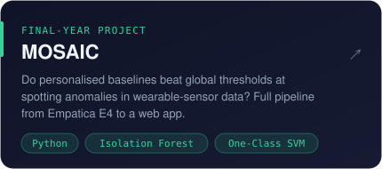
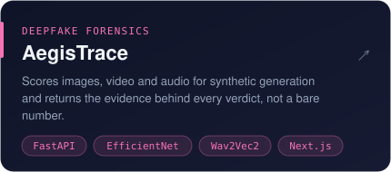
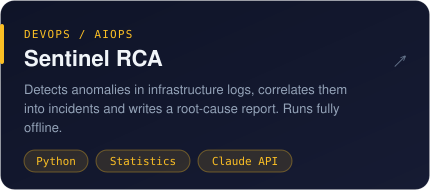
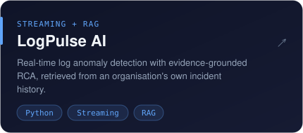
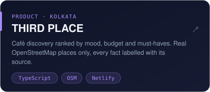
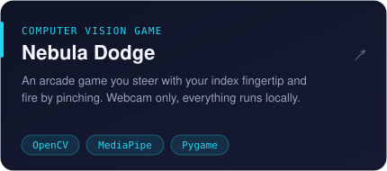
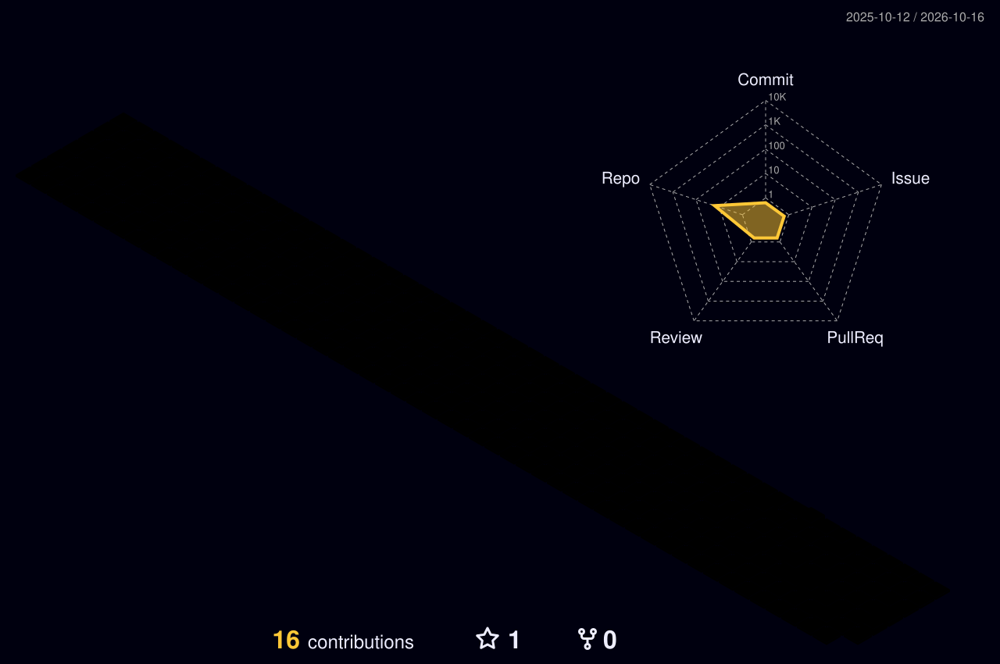

 

<!-- Add your links here, e.g. LinkedIn / email / portfolio -->

### 👋 About me

- 🎓 Final-year **B.Tech CSE (Data Science)** student
- 🧠 I work on **anomaly detection**, **retrieval-augmented generation** and **ML forensics**
- 🔍 What my projects have in common: every result comes with the evidence behind it
- 🌱 Currently building **MOSAIC**, my major project on personalised baselines for wearable-sensor data

### 🚀 Featured projects

<table>
  <tr>
    <td width="50%"></td>
    <td width="50%"></td>
  </tr>
  <tr>
    <td width="50%"></td>
    <td width="50%"></td>
  </tr>
  <tr>
    <td width="50%"></td>
    <td width="50%"></td>
  </tr>
</table>

<b>More experiments</b>

 

| Project | What it is |
|---|---|
| [ai-candidate-chatbot-v2](https://github.com/Tanisha-dey18/ai-candidate-chatbot-v2) · [live ↗](https://ai-candidate-chatbot-v2-ten.vercel.app) | AI interview / candidate chatbot |
| [AI-Resume-Evaluator](https://github.com/Tanisha-dey18/AI-Resume-Evaluator) | Scores résumés with an LLM |
| [simple-rag-pipeline](https://github.com/Tanisha-dey18/simple-rag-pipeline) | A minimal retrieval-augmented generation pipeline |
| [ai-agent](https://github.com/Tanisha-dey18/ai-agent) | Tool-using agent experiments |
| [fasal-raksha-backend](https://github.com/Tanisha-dey18/fasal-raksha-backend) | Backend for a crop-protection app |

### 🌃 Contribution city

  <picture>
    <source media="(prefers-color-scheme: dark)" srcset="profile-3d-contrib/profile-night-rainbow.svg"/>
    <source media="(prefers-color-scheme: light)" srcset="profile-3d-contrib/profile-season-animate.svg"/>
    
  </picture>

  <picture>
    <source media="(prefers-color-scheme: dark)" srcset="dist/snake-dark.svg"/>
    <source media="(prefers-color-scheme: light)" srcset="dist/snake-light.svg"/>
    
  </picture>

Rebuilt every night by a GitHub Action from my real contribution calendar.

### 🛠️ Toolbox

  <b>Languages</b>  
  

  <b>ML &amp; data</b>  
  

  <b>Web &amp; infra</b>  
  

Built with care · open to internships and collaborations · ⭐ a repo if it helped you

